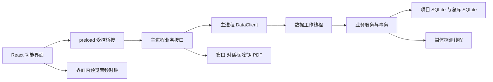

# WaterCut 架构与学习入口

本目录说明运行边界、功能实现位置和保存规则。当前重构基于 v1.4.3 的提交 0f34caa，项目格式 v11、总库格式 v4 保持不变。

## 运行边界

- renderer：React 界面、编辑状态及预览音频。禁止直接使用 Node、Electron、数据库。
- preload：固定白名单桥接，向界面提供 WaterCutAPI。
- main：启动、窗口、受控 IPC、对话框、媒体协议、系统密钥与 PDF。
- workers：数据任务排队与媒体探测。数据库业务通过数据线程执行。
- modules：项目、总库、跨库协调、媒体及交付业务。
- infrastructure：后台共用的文件与任务工具，不依赖界面。
- contracts：跨进程参数、返回值与事件。
- shared：跨环境通用类型、校验和纯计算，不访问 DOM、Node 或 Electron。

## 保存不变量

1. 项目数据库的一次编辑使用同一连接和事务；脚本与镜头顺序共同提交。
2. 项目与总库通过 outbox 和对账同步，总库离线不阻断项目保存。
3. 自动保存先保留本地编辑，再串行写入；旧响应不能覆盖待保存内容。
4. 切换、快照、导出和退出必须等待保存；失败保留可重试任务。
5. 文件任务取消后先等流和工作线程结束，再清理专属临时目录。
6. 预览以 AudioContext 为共同时间基准；音乐准备时不反复定位暂停的视频。

## 阅读入口

- [功能定位表](./模块与功能定位.md)：查某个功能的界面、接口、业务、持久化和测试位置。
- [学习路线](./学习路线.md)：从一个操作追踪完整调用链。
- [迁移记录](./迁移记录.md)：基线、独立提交、文件对应关系与回退方式。
- [开发与验证](../development/README.md)：统一命令、原生场景和报告位置。
- [界面主题与样式](./界面主题与样式.md)：主题变量、样式文件与几何组件的位置。
- [发布清单](../releases/RELEASE_CHECKLIST.md)：当前版本实际验收状态。

## 调用关系

`main/main.ts` 只组装启动顺序；`workers/data-worker.ts` 负责串行调用和取消；业务与 SQL 位于 `modules`。界面预览的 Web Audio 运行在 renderer，不进入后台共享层。

## 扩展规则

1. 功能组件只从其他功能的 `index.ts` 读取公开能力。跨后台模块也使用各自 `index.ts`；模块内部可以直接引用同模块实现。
2. 界面能力在 `contracts/api.ts` 定义；数据线程命令在 `contracts/worker.ts` 定义并同时形成运行时白名单。类型不能代替 Zod、项目目录授权和真实路径检查。
3. 新增编辑操作先确定事务负责人，再实现 SQL。单个操作的读写函数共享该事务连接，不能在底层函数各自提交。
4. 自动保存只交给一个 `SaveCoordinator`。表单先捕获用户选择，再等待保存；不要在异步等待后重新读取受控 DOM 的值。
5. `npm run check` 检查格式、零警告、依赖方向、运行时循环、通信注册、源码不变量和类型；`npm test` 验证实际业务行为。
6. 完整性清单保护本次重构的 SQL 值、模板和合成样例。后续有意修改业务 SQL 或格式时，应在独立功能提交中说明变更并更新对应测试和清单，不能用更新清单掩盖重构中的差异。

全局样式集中在 `renderer/styles`，`index.css` 只声明导入顺序，颜色与尺寸在 `tokens.css`，其余按壳层、首页和各功能拆分。界面规范见仓库根目录 `DESIGN.md`。共享图标与几何图形放在 `renderer/ui`；有业务含义的资源卡片归入 `features/resources`。
